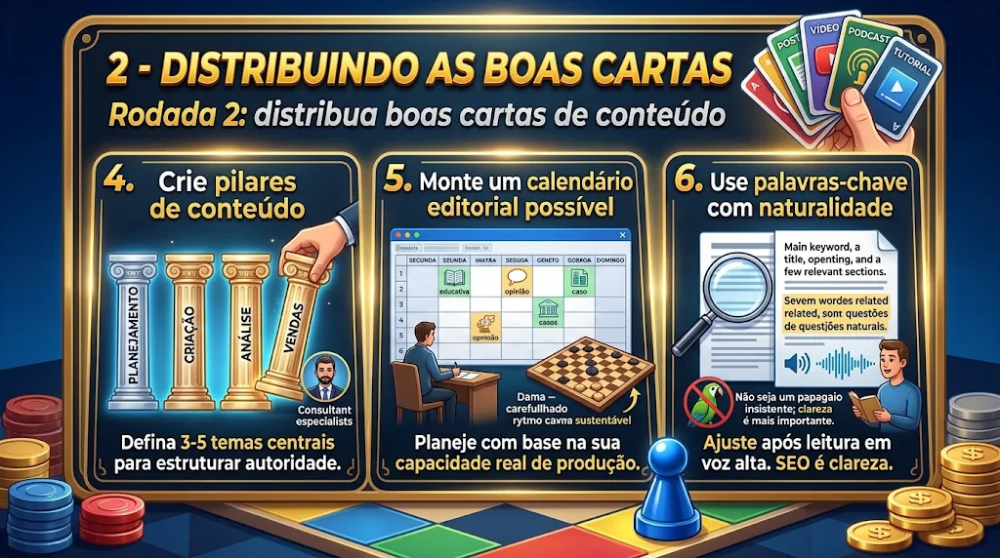

Imagine a internet como uma mesa de jogos. Há quem jogue xadrez, quem aposte tudo numa carta e quem só queira tirar seis no dado. Porém, no marketing, depender de sorte costuma sair caro. Construir **autoridade digital** exige método, treino e escolhas que façam sentido para quem está do outro lado da tela.

A boa notícia? Você não precisa de uma fórmula secreta, um orçamento gigantesco ou uma capa de super-herói. Precisa entender o público, resolver problemas reais e aparecer com consistência. Afinal, **autoridade digital** não é sinônimo de falar mais alto. É ser lembrado quando alguém precisa de uma resposta confiável.

Neste guia, o tabuleiro tem 27 casas. Cada dica apresenta uma jogada prática. Você pode começar hoje, mesmo que ainda esteja organizando suas peças. Prepare o café, distribua as cartas e avance sem procurar atalhos milagrosos.

**Como deve ser | [SEO em 2027](https://maestriageo.com.br/seo-em-2027/)**

## Rodada 1: monte o tabuleiro da autoridade digital

Antes de correr atrás de seguidores, prepare o terreno. O reconhecimento cresce melhor quando existe direção.

### 1. Escolha um nicho claro

No xadrez, ninguém vence tentando mover todas as peças ao mesmo tempo. Da mesma forma, querer conversar com todo mundo costuma produzir mensagens genéricas. Escolha um tema em que tenha conhecimento e uma audiência que possa ajudar. Por exemplo, troque “falo de negócios” por “ensino pequenos restaurantes a vender pelo Instagram”. **Quanto mais claro o foco, mais fácil construir autoridade digital** sem se perder em assuntos aleatórios.

### 2. Entenda quem está do outro lado do tabuleiro

Antes de lançar conteúdo, investigue as dúvidas do público. Leia comentários, converse com clientes e observe perguntas recorrentes. Quais problemas tiram seu sono? Que palavras usam para explicá-los? Essas respostas valem mais que palpites. Crie um retrato simples do leitor: necessidades, objeções e objetivos. Assim, cada publicação tem um destinatário real, e sua **autoridade digital** passa a nascer da utilidade, não da adivinhação.

### 3. Defina sua proposta única

Em um baralho, muitas cartas parecem iguais até chegar a jogada decisiva. Pergunte: por que alguém escolheria seu conteúdo entre tantos outros? Talvez você explique assuntos difíceis com exemplos cotidianos. Talvez tenha experiência prática em um setor específico. Escreva sua promessa em uma frase simples. **Diferenciação não é inventar personagem**. É mostrar o valor que você entrega. Essa clareza dá personalidade à sua autoridade digital.

## Rodada 2: distribua boas cartas de conteúdo

Conteúdo é sua mão no jogo. Para ampliar a **autoridade digital**, escolha cartas úteis, não apenas chamativas.

### 4. Crie pilares de conteúdo

Pense em três a cinco assuntos centrais. Um consultor de marketing, por exemplo, pode trabalhar planejamento, criação, análise e vendas. Cada pilar vira fonte de tutoriais, histórias, exemplos e respostas. Isso evita o perfil que hoje fala de SEO e amanhã ensina a fazer pão sem motivo algum. **Organização temática ajuda o leitor a reconhecer sua especialidade**. E especialidade reconhecível fortalece a autoridade digital ao longo do tempo.

### 5. Monte um calendário editorial possível

Não adianta prometer sete publicações semanais e desaparecer na terça-feira. Abra uma planilha e planeje o que realmente consegue produzir. Alterne conteúdos educativos, opiniões fundamentadas e casos práticos. Reserve tempo para revisão e atualização. No jogo de damas, avançar uma casa com segurança pode ser melhor que arriscar todas. A **autoridade digital** se beneficia de um ritmo sustentável, não de surtos de produtividade seguidos por silêncio.

### 6. Use palavras-chave com naturalidade

A palavra-chave indica o assunto da página, mas não precisa virar um papagaio insistente. Coloque o termo principal no título, na abertura e em trechos relevantes. Depois, escreva para pessoas. Inclua sinônimos e perguntas relacionadas, sem forçar frases. Faça uma revisão em voz alta: ficou estranho? Ajuste. **SEO não é um concurso de repetição**. Para desenvolver autoridade digital, clareza e resposta completa importam mais que truques de contagem.

## Rodada 3: pense como quem joga xadrez

Uma presença bem organizada evita movimentos desperdiçados. A **autoridade digital** também depende da experiência de navegação.

### 7. Otimize títulos e descrições

Seu título funciona como a primeira jogada: precisa explicar por que vale clicar. Prometa algo concreto e entregue exatamente isso. A descrição exibida nos resultados pode resumir o benefício e convidar à leitura, embora o buscador possa reescrevê-la. Evite títulos dramáticos que entregam pouco. **Curiosidade atrai; relevância faz ficar**. Para sua autoridade digital, um clique satisfeito é mais valioso que uma promessa exagerada.

### 8. Organize os links internos

Um site sem caminhos lembra um tabuleiro com peças espalhadas no chão. Conecte artigos relacionados por links que ajudem o visitante a avançar. Um texto sobre planejamento pode apontar para outro sobre calendário editorial, por exemplo. Use âncoras descritivas, nunca uma fileira de “clique aqui”. Assim, você melhora a descoberta do conteúdo e facilita a leitura. **Links internos bem escolhidos** sustentam sua autoridade digital sem precisar de malabarismo.

**Leia também | [Política online](https://maestriageo.com.br/politica-online/)**

### 9. Melhore a experiência do usuário

Imagine tentar jogar ludo num tabuleiro sem números e com peças invisíveis. Irritante, certo? Um site confuso provoca reação parecida. Prefira menus simples, fontes legíveis, páginas acessíveis e botões claros. Reduza anúncios que interrompem a leitura. Teste tudo no celular e peça a alguém para encontrar uma informação específica. Se a pessoa tropeçar, corrija. **Facilidade de uso transmite cuidado**, ingrediente essencial da autoridade digital.

## Rodada 4: vença no jogo de damas com constância

Não é preciso capturar tudo numa jogada. A **autoridade digital** se desenvolve em movimentos consistentes.

### 10. Publique com frequência sustentável

Constância não significa postar o tempo inteiro. Significa cumprir uma promessa realista. Um artigo excelente por semana pode ajudar mais que cinco textos apressados. Defina dias de produção, revisão e distribuição. Se faltar assunto, volte às perguntas do público. No jogo de damas, a sequência de boas decisões conta mais que a correria. **Regularidade cria expectativa** e ajuda sua autoridade digital a permanecer na memória das pessoas.

### 11. Mantenha identidade visual reconhecível

Cores, tipografia e estilo de imagem ajudam o leitor a identificar seu trabalho. Não é necessário transformar cada publicação num carnaval gráfico. Escolha uma paleta, padronize capas e preserve a leitura. Sua voz também faz parte da identidade: seja técnico quando necessário e humano sempre. **Coerência visual e editorial facilita o reconhecimento**. Com o tempo, essa familiaridade reforça a autoridade digital sem depender de logotipos gigantes.

### 12. Reaproveite conteúdos com inteligência

Uma boa partida pode render várias lições. Transforme um artigo em carrossel, vídeo curto, newsletter ou checklist. Porém, adapte a linguagem ao canal. Não basta recortar o mesmo texto e espalhar por toda parte. Atualize exemplos, responda novas perguntas e crie formatos complementares. **Reaproveitar não é repetir mecanicamente**. É ampliar o acesso a uma ideia útil. Assim, sua autoridade digital alcança públicos com hábitos diferentes.

## Rodada 5: cartas de confiança para autoridade digital

Sem confiança, nem o melhor baralho resolve. Credibilidade exige demonstrações concretas.

### 13. Mostre provas sociais verdadeiras

Depoimentos, avaliações e resultados documentados ajudam pessoas indecisas. Mas nada de inventar clientes felizes ou gráficos milagrosos. Apresente contexto: qual era o desafio, o que foi feito e quais resultados podem ser comprovados? Peça autorização antes de divulgar histórias. Um testemunho específico costuma explicar mais que dez elogios vagos. **Prova social é evidência, não decoração**. A sua autoridade digital precisa resistir a perguntas, não apenas impressionar à primeira vista.

### 14. Cite fontes confiáveis

No xadrez, não vale mudar as regras no meio da partida. Com dados, também não. Quando apresentar números ou afirmações técnicas, informe de onde vieram. Prefira estudos originais, documentos oficiais e especialistas identificáveis. Consulte também as [orientações do Google sobre conteúdo útil](https://developers.google.com/search/docs/fundamentals/creating-helpful-content?hl=pt-br). Confira datas e contexto antes de compartilhar. Se houver incerteza, diga isso claramente. **Admitir limites pode aumentar a confiança**. Afinal, autoridade digital não exige saber tudo; exige tratar a informação com responsabilidade.

### 15. Mostre quem escreve e por quê

Um texto sem autoria pode até ser útil, mas deixa perguntas no ar. Crie uma página com nome, experiência verificável, área de atuação e formas de contato. Explique como o conteúdo é preparado e revisado. Se houver profissionais convidados, identifique cada participação. Evite currículos inflados e títulos inventados. **Transparência aproxima pessoas**. E uma autoridade digital sustentável tem rosto, história e responsabilidade pelo que publica.

## Rodada 6: jogue ludo com a comunidade

A partida fica melhor quando há troca. A **autoridade digital** também depende de relacionamento, não só de alcance.

### 16. Responda aos comentários com atenção

Comentários são conversas, não números para enfeitar relatórios. Responda perguntas, agradeça contribuições e reconheça críticas pertinentes. Se não souber algo, pesquise antes de responder. O importante é mostrar presença real. Uma boa resposta pode inspirar o próximo artigo, além de revelar dúvidas que você nem imaginava. **Escuta ativa transforma seguidores em comunidade**. Esse vínculo dá profundidade à sua autoridade digital, muito além das curtidas.

### 17. Incentive compartilhamentos que façam sentido

Ninguém precisa implorar por compartilhamentos a cada parágrafo. Produza algo que mereça circular: um modelo útil, uma explicação clara ou uma comparação que resolva dúvidas. Ao final, convide o leitor a enviar o material a quem possa precisar. Simples assim. No ludo, a peça avança quando encontra caminho. **Valor compartilhável amplia a descoberta** e pode levar sua autoridade digital a novas conversas relevantes.

### 18. Faça chamadas para ação claras

Depois de ajudar, indique o próximo passo. Pode ser ler outro artigo, baixar um checklist, comentar uma experiência ou entrar em contato. Prefira convites específicos: “Veja o modelo de calendário” informa mais que “Saiba mais”. Evite colocar cinco botões competindo pela mesma atenção. **Uma boa chamada orienta sem pressionar**. Assim, a autoridade digital deixa de ser só percepção e começa a gerar relacionamentos e oportunidades concretas.

## Rodada 7: não esqueça das regras técnicas

Até o melhor jogador perde num tabuleiro quebrado. A **autoridade digital** precisa de uma base técnica confiável.

### 19. Faça seu site carregar rápido

Um visitante não deveria precisar de paciência de monge para abrir um artigo. Comprima imagens, evite recursos desnecessários e revise scripts pesados. Use o [PageSpeed Insights](https://pagespeed.web.dev/) para localizar problemas antes de sair apagando tudo. Priorize melhorias que beneficiem pessoas reais. **Velocidade reduz atritos na navegação**, especialmente em conexões móveis. Sua autoridade digital ganha quando o conteúdo é acessível sem espera excessiva.

### 20. Coloque a experiência mobile em primeiro plano

Muita gente chega pelo celular, com uma mão ocupada e poucos segundos disponíveis. Por isso, confira títulos, espaçamento, menus e campos de formulário em telas pequenas. Botões não devem exigir dedos de pianista. Também verifique contraste e acessibilidade. Um layout bonito no computador pode ser um labirinto no telefone. **Design responsivo é requisito básico de usabilidade** e protege sua autoridade digital de experiências frustrantes.

### 21. Corrija erros e links quebrados

Páginas inexistentes, formulários que falham e imagens que somem parecem casas faltando no tabuleiro. Faça revisões periódicas. Resolva links quebrados, configure redirecionamentos quando fizer sentido e mantenha páginas importantes acessíveis. Consulte relatórios de indexação e teste caminhos essenciais. Nem todo aviso exige pânico, mas erros recorrentes merecem atenção. **Manutenção silenciosa evita prejuízos visíveis** e ajuda a preservar a autoridade digital conquistada.

## Rodada 8: expanda o jogo sem blefar

Chegou a hora de alcançar outras mesas. A **autoridade digital** cresce com boas conexões e exposição relevante.

### 22. Faça parcerias e publique como convidado

Uma colaboração com alguém do mesmo setor pode aproximar públicos interessados. Convide especialistas para entrevistas, participe de eventos e ofereça artigos realmente úteis a sites pertinentes. Não trate parcerias como fábrica de links. Busque troca de conhecimento e afinidade editorial. **Relacionamentos genuínos abrem portas duradouras**. Ao contribuir com qualidade fora dos próprios canais, você amplia sua autoridade digital sem precisar blefar no truco.

### 23. Conquiste backlinks de qualidade

Um backlink é um link de outro site apontando para o seu. Quando surge de maneira editorial e relevante, pode ajudar pessoas a descobrir seu trabalho e contribuir para sinais de reputação. Crie pesquisas, guias e ferramentas que mereçam referência. Evite comprar pacotes de links ou participar de esquemas artificiais. **Um bom link tem contexto e propósito**. Para autoridade digital, reputação vale mais que quantidade bruta.

### 24. Marque presença em canais estratégicos

Estar em todas as redes não é vitória automática. Escolha onde sua audiência conversa e consome informação. Talvez seja LinkedIn, YouTube, newsletter ou comunidade especializada. Adapte cada formato e mantenha um espaço próprio, como o site, para organizar conteúdos duradouros. **Distribuição inteligente supera dispersão**. Assim, a autoridade digital não fica refém de uma única plataforma nem de uma mudança inesperada no algoritmo.

## Rodada 9: a maratona da autoridade digital

O troféu não aparece após duas rodadas. O resultado melhora com análise, atualização e paciência.

### 25. Monitore métricas que importam

Não confunda placar bonito com resultado útil. Além de visualizações, observe tráfego orgânico, consultas de pesquisa, tempo de engajamento, conversões e retorno de visitantes. Compare períodos adequados e procure tendências, não milagres de segunda-feira. Ferramentas como Google Search Console e Analytics podem ajudar. **Métricas orientam decisões, não substituem estratégia**. A autoridade digital cresce melhor quando você aprende com dados e ajusta suas escolhas.

### 26. Atualize o que já foi publicado

Um guia antigo pode continuar valioso, desde que não vire peça de museu. Revise estatísticas, links, exemplos e instruções. Acrescente respostas a dúvidas novas e retire informações ultrapassadas. Faça mudanças reais, não apenas troque a data no topo. Registre o que foi modificado quando isso ajudar o leitor. **Atualização de verdade preserva a utilidade**. Sua autoridade digital se fortalece quando o acervo permanece confiável e relevante.

### 27. Tenha paciência e ajuste a estratégia

No xadrez, uma boa posição se constrói ao longo de várias jogadas. Com conteúdo, acontece algo semelhante. Teste formatos, observe resultados e continue aprendendo. Se um canal não funcionar, descubra o motivo antes de abandonar tudo. Evite comparar seu começo com o meio do jogo de outra pessoa. **Consistência com revisão é melhor que teimosia**. Autoridade digital não nasce numa noite; amadurece quando promessa e entrega se encontram repetidamente.

## Conclusão: não existe carta mágica

Construir presença sólida é um jogo de decisões repetidas. Você escolhe o nicho, cria conteúdo útil, cuida do site, conversa com pessoas e aprende com os resultados. Algumas jogadas rendem rápido. Outras exigem temporadas inteiras.

O segredo menos secreto de todos é este: **autoridade digital se conquista quando você ajuda de forma consistente e demonstra que merece confiança**. Portanto, escolha três dicas para aplicar nesta semana. Execute, avalie e avance uma casa por vez. O tabuleiro é grande. Não há motivo para jogar todas as cartas hoje.

